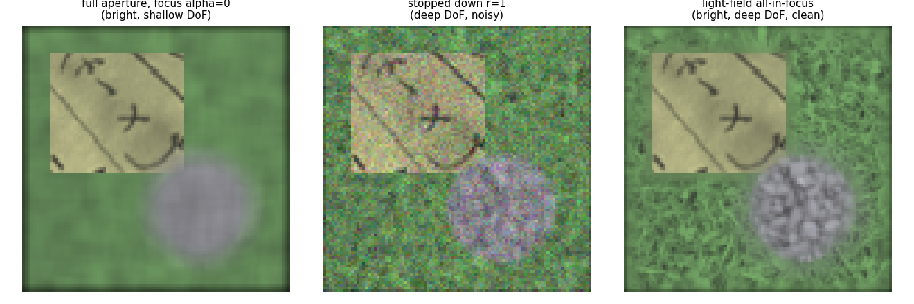
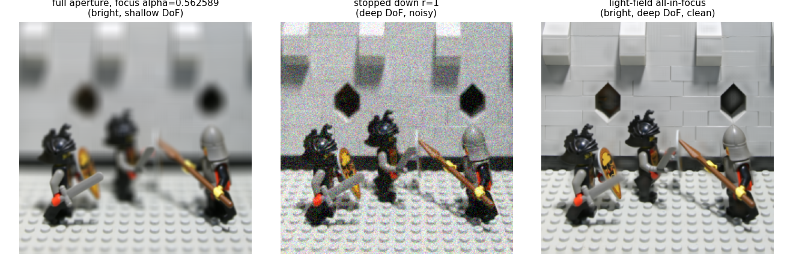
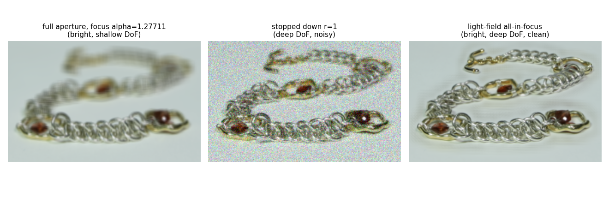
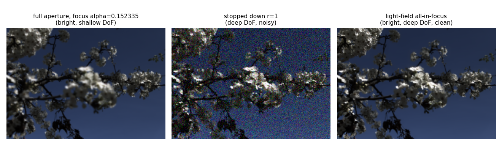

# 06 - Extended depth of field (all-in-focus)

## 1. In one paragraph
A conventional camera ties depth of field to aperture: stop down (f/22) and everything is sharp but little light reaches the sensor, so the photo is noisy; open up (f/4) and the photo is bright but only one depth is sharp. A light field captured at f/4 keeps all the light and can be refocused to any depth afterwards, so we can pick, per pixel, the sharpest refocus and merge them into one all-in-focus image (lecture 15, slides 58-59). Code: `lf/edof.py`.

## 2. Theory
Refocusing at `alpha` is a shear of the light field followed by integration over the aperture (slide 14: refocusing shears the light field, it does not deblur by depth). A point of disparity `d` is sharp in `I_alpha` iff `alpha = d`. The focal stack `{I_alpha}` therefore contains every scene point sharp in at least one slice. Selecting the sharp slice per pixel is the digital photomontage problem (Agarwala et al. 2004), which they solve as an MRF with graph cuts for seamless labels. We use a cheaper local method: soft per-pixel sharpness weights, spatially smoothed. This is not guaranteed to be consistent across boundaries and can show halos.

Light vs DoF vs noise: a pinhole-like image (small aperture) has area ratio `A_small / A_full` of the light, and with shot-noise-limited capture SNR drops by `sqrt` of that ratio. The light field breaks the aperture-DoF link: it integrates all angular samples (full light) only after aligning them, so each refocused slice is bright and the merged image is sharp and clean. The price is spatial resolution traded for angular samples.

## 3. Algorithm
1. Focal stack `I_k` for the candidate alphas.
2. Sharpness `F_k(x)`: window-averaged Laplacian^2 (or Tenengrad, variance).
3. Normalise `z_k = F_k / max_k F_k`, weights `w_k = exp(beta (z_k - 1))`.
4. Smooth each `w_k` (guided filter with the centre view as guide, Gaussian, or none = hard argmax).
5. `image = sum_k w_k I_k / sum_k w_k`; `index_map = argmax_k w_k`.

## 4. Implementation notes
* `all_in_focus(lf, alphas, measure, window, smoothing='guided'|'gaussian'|'none', sigma, radius, eps, beta)` returns `image`, `index_map` (int into `alphas`), `disparity = alphas[index_map]`, `focus_measure`.
* Guided radius matters: a large radius blurs the weights and the result gets less sharp than the sharpest single slice (we saw this at radius 6; default is 3).
* `compare_with_stop_down` returns (full aperture at `focus_alpha`, stopped down, all-in-focus). Stop-down uses `lf.aperture.stop_down` if it exists, otherwise a circular angular mask through `refocus`. With `noise_sigma`, the stopped-down image gets Gaussian noise of std `noise_sigma * sqrt(A_full/A_small)`. Full and all-in-focus images are left noise-free (they use the full light budget).
* Borders: shear uses nearest padding so a dark/streaky margin of a few pixels appears.

## 5. Experiments

`edof_synthetic.png` (slide-58 style): left, full aperture focused on the text plane, so the grass and gravel are blurred; middle, stopped down to the central 5 views with noise, sharp everywhere but grainy; right, the all-in-focus composite, sharp on all three layers and clean. Look at the gravel texture and at the grass.

Quantitatively, the tests check that the composite has a larger Laplacian variance than every single refocused slice and matches the centre view within the `d = 0` text region (mean abs error < 0.03). Real-dataset versions use the depth-figure settings of doc 07 and focus at the 90th percentile of the estimated disparity (the Lytro one at downsample 2).


`edof_lego.png` (focus alpha 0.56): the full aperture is sharp only near the knights, with the wall blurred. The stopped-down image (radius 1, 5 views) is sharp everywhere but grainy, and the composite keeps the wall tiles, knights and floor clean. Check the wall and floor tiles in the composite.


`edof_bracelet.png` (focus alpha 1.28): in the full-aperture image the top clasp and the far part of the chain are blurred. The composite brings the whole chain, top clasp included, into focus with the noise of the stopped-down version removed. Check the top clasp.


`edof_lytro.png` (focus alpha 0.15): the blossoms are blurred in the full-aperture image. The stopped-down version is speckled, most visibly over the dark sky, and the composite keeps blossoms and sky clean. Check the sky for noise.

## 6. Try it
```python
import numpy as np, lf
from lf import edof
L = lf.synthetic.synthetic_light_field(n_views=7, size=96)
full, stopped, aif = edof.compare_with_stop_down(L, np.linspace(-1.5, 2, 15), noise_sigma=0.02)
```
`python scripts/make_figures_depth.py` regenerates the figures.

## 7. Limitations and extensions
Halos at depth edges (the local rule has no global consistency; try graph cuts or an MRF on `index_map`). Sharpness measures fail in flat regions, but there the choice does not matter visually. Slices sampled at a coarse alpha grid may leave in-between depths slightly soft; use a denser grid or interpolate the disparity from `depth.py` and refocus per pixel. A depth map from `lf/depth.py` can drive the composite directly.

## 8. References
* Agarwala, A., Dontcheva, M., Agrawala, M., Drucker, S., Colburn, A., Curless, B., Salesin, D., Cohen, M. "Interactive digital photomontage." ACM SIGGRAPH 2004 (ACM TOG 23(3)).
* Ng, R., Levoy, M., Bredif, M., Duval, G., Horowitz, M., Hanrahan, P. "Light field photography with a hand-held plenoptic camera." Stanford Tech Report CTSR 2005-02.
* He, K., Sun, J., Tang, X. "Guided image filtering." IEEE TPAMI 35(6), 2013.
