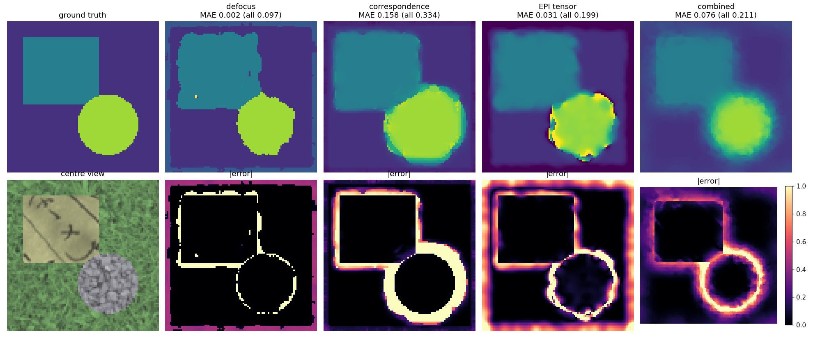
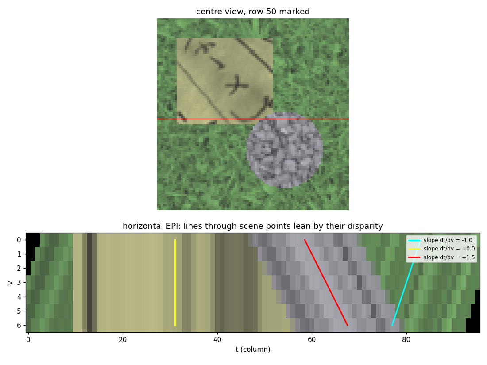
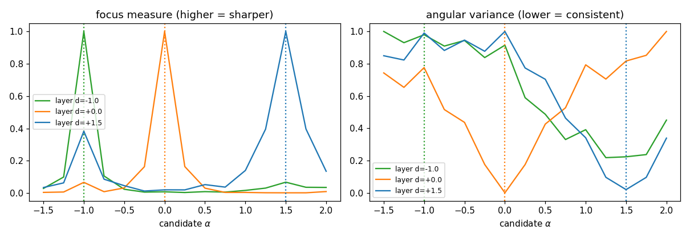
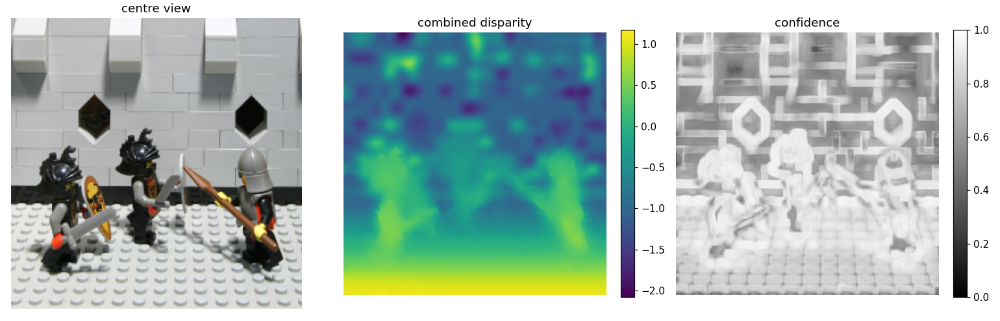
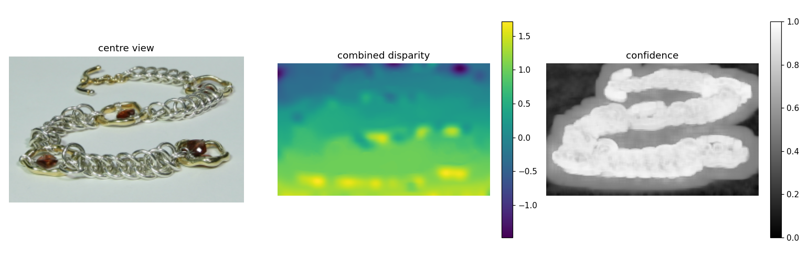
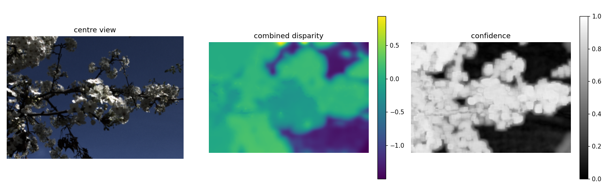

# 07 - Depth (disparity) estimation from a light field

## 1. In one paragraph
A light field samples a scene from many viewpoints, so depth is encoded in how a point moves between views. We estimate this disparity three ways: by finding the refocus setting where a pixel is sharpest (defocus cue), by finding the shear where all views agree (correspondence cue), and by measuring the slope of lines in epipolar-plane images with a structure tensor. A confidence-weighted fusion of the first two, smoothed with a guided filter, follows Tao et al. (2013). Code: `lf/depth.py`.

## 2. Theory
**EPIs.** Fix an image row `s` and angular row `u0` and stack the row over `v`: this is the horizontal EPI `E(v, t)`. A scene point of disparity `d` appears at `t = t0 + d (v - v0)`, so it traces a straight line of slope `dt/dv = d` (Bolles, Baker & Marimont 1987). Occlusion shows up as a nearer (steeper) line overwriting a farther one. Depth estimation becomes line-slope estimation (lecture 15, slide 15).

**Defocus cue.** Refocusing on the plane `alpha` aligns points with `d = alpha`, which then look sharp. So `d(x) = argmax_alpha F(alpha, x)` where `F` is a local sharpness measure. It needs texture and is fairly robust at occlusions (the sharp side wins), but it is blind in flat regions.

**Correspondence cue.** After shearing by `alpha`, a point with `d = alpha` has the same colour in all `U*V` views, so the angular variance is minimal. It is a photo-consistency test (the EPI slope made explicit). It also needs texture, and fails at occlusions (views see different surfaces) and on repetitive texture (several minima). Tao et al. point out that the two cues fail in complementary ways, which is why they are combined.

**Structure tensor** (Wanner & Goldluecke 2012). Along an EPI line the intensity is constant, so the gradient `(E_v, E_t)` is perpendicular to direction `(1, d)`: `E_v + d E_t = 0`, `d = -E_v/E_t`. The smoothed tensor `J = G * [[E_v^2, E_v E_t],[E_v E_t, E_t^2]]` gives the dominant orientation `phi = 0.5 atan2(2 J_vt, J_vv - J_tt)` and `d = -cot(phi)`. Sign check: our convention says nearer points have `d > 0` and move to larger `t` as `v` grows, so lines lean right going down the EPI (see `epi_slopes.png`); the unit tests verify +1.5 comes out positive and -1 negative. The vertical EPI gives a second estimate, fused using coherence weights.

**Disparity vs depth.** For a camera translating by baseline `b` per angular step, focal length `f` (px), a point at depth `z` has disparity `f b / z`. Relative to a rectification plane at `z0` (our `d = 0`): `d = f b (1/z - 1/z0)`, so `z = f b / (d + f b / z0)`: depth goes as `1/(d + const)`. That is nonlinear, noise blows up at large `z`, and `z0`, `f`, `b` are often unknown, which is why all comparisons are done in disparity. `disparity_to_depth` does the conversion.

## 3. Algorithm
1. Choose a grid of candidate `alphas` covering the scene disparity range.
2. Defocus: focal stack, window-averaged sharpness (Laplacian^2, Tenengrad, or local variance), argmax over alpha, parabolic sub-sample refinement through the three samples around the peak.
3. Correspondence: for each alpha shear the LF, take the variance over `U*V` views (mean over channels), window-average, argmin, same refinement.
4. Confidence: peak prominence `(peak - mean)/peak` of the cost curve (for focus also scaled down where the peak sharpness is negligible).
5. Fusion: per-pixel min-max normalise each volume to a match score in [0,1], `S = c_def S_def + c_cor S_cor`, argmax + refinement.
6. Smoothing: normalised convolution with a guided filter on the centre view, `d = GF(c d) / GF(c)`, then a 3x3 median.

## 4. Implementation notes
* `depth_from_focus`, `depth_from_correspondence`, `epi_structure_tensor_disparity`, `depth_combined`, `evaluate`, `disparity_to_depth`, plus helpers `focus_measure`, `guided_filter`, `discontinuity_mask`.
* `cost_volume` is the focus measure (higher = better) for defocus and the variance (lower = better) for correspondence.
* `cv2.ximgproc` is not required; the guided filter is ~10 lines with box filters.
* Shearing uses `mode='nearest'`, so a margin of roughly `alpha * U/2` pixels at the image border is unreliable. Evaluate with `border=8`.
* `evaluate` excludes a 3-px band around gt discontinuities: windows there straddle two surfaces, so the "right" answer is ambiguous and the error mostly measures window size. All-pixel numbers (`*_all`) are reported too. Bad pixel = error > 0.25.
* Cost: `n_alpha * U * V` image shifts; the 96-px synthetic LF with 15 alphas takes under a second per estimator.

## 5. Experiments
Synthetic scene (7x7 views, 96 px, 15 alphas in [-1.5, 2], `border=8`):

| estimator | MAE | RMSE | bad px | MAE (all px) |
|---|---|---|---|---|
| defocus (Laplacian, w=7) | 0.002 | 0.052 | 0.001 | 0.097 |
| correspondence (w=5) | 0.158 | 0.537 | 0.090 | 0.334 |
| EPI structure tensor | 0.031 | 0.177 | 0.014 | 0.199 |
| combined (smoothed) | 0.076 | 0.163 | 0.108 | 0.211 |


`depth_synthetic.png`: ground truth, the four estimates and error maps. Look at where errors live: at layer boundaries and the image border. Correspondence and the tensor produce wide halos at the gravel disc (window or derivative support); defocus gives crisp but blocky boundaries. The combined map is smooth and edge-aligned but, on this scene, not better than defocus alone (the correspondence cue drags it down on the grass). Fusion helps when one cue fails entirely, not when one cue is already near-perfect.


`epi_slopes.png`: horizontal EPI at row 50. The overlaid lines with slopes -1, 0, +1.5 follow the grass, text and gravel streaks. Note the nearest layer's streaks move fastest and occlude the others.


`cost_volume_profile.png`: for one pixel per layer, the focus measure peaks and the variance dips at the true disparity (dotted lines). The curves are broader for low-texture layers, which is what the confidence measures.

Real datasets were run through the same estimator: Lego and Bracelet at downsample 4 with 9x9 views and alphas in [-3, 3], Lytro at downsample 2 with 9x9 views and alphas in [-1.5, 1.5]. There is no ground truth, so we report the 2nd / 50th / 98th percentiles of the combined disparity (pixels per angular step): lego -1.42 / -0.50 / 1.04, bracelet -0.64 / 0.51 / 1.45, lytro -1.35 / -0.04 / 0.23.


`depth_lego.png`: the knights and the near floor come out positive and the castle wall negative. The wall has almost no texture, so its estimates are blotchy.


`depth_bracelet.png`: the near links at the bottom of the chain are positive and the far top is negative. Confidence is high on the chain and low on the plain background, which is where the estimates are least trustworthy.


`depth_lytro.png`: noisier than the gantry results, with small sub-pixel disparities (98th percentile 0.23). The dark sky gives the least reliable values.

## 6. Try it
```python
import numpy as np, lf
from lf import depth
L = lf.synthetic.synthetic_light_field(n_views=7, size=96)
r = depth.depth_combined(L, np.linspace(-1.5, 2, 15))
print(depth.evaluate(r['disparity'], L.meta['gt_disparity'], border=8))
```
Reproduce figures with `python scripts/make_figures_depth.py`.

## 7. Limitations and extensions
Textureless regions have no solution from either cue (needs a global prior, e.g. MRF/TV as in Tao and Wanner). Occlusion handling is absent (a better correspondence cost would use only the unoccluded views, Wang et al. 2015). Small angular baselines give a limited disparity range; large disparities alias in the structure tensor unless the EPI is smoothed or the LF is downsampled. Try a different window, a colour guide, or a cost-volume smoothing instead of disparity smoothing.

## 8. References
* Bolles, R. C., Baker, H. H., Marimont, D. H. "Epipolar-plane image analysis: an approach to determining structure from motion." IJCV 1(1), 1987.
* Tao, M. W., Hadap, S., Malik, J., Ramamoorthi, R. "Depth from combining defocus and correspondence using light-field cameras." ICCV 2013.
* Wanner, S., Goldluecke, B. "Globally consistent depth labeling of 4D light fields." CVPR 2012.
* He, K., Sun, J., Tang, X. "Guided image filtering." IEEE TPAMI 35(6), 2013.
* Ng, R., et al. "Light field photography with a hand-held plenoptic camera." Stanford Tech Report CTSR 2005-02.
* Wang, T.-C., Efros, A., Ramamoorthi, R. "Occlusion-aware depth estimation using light-field cameras." ICCV 2015.
